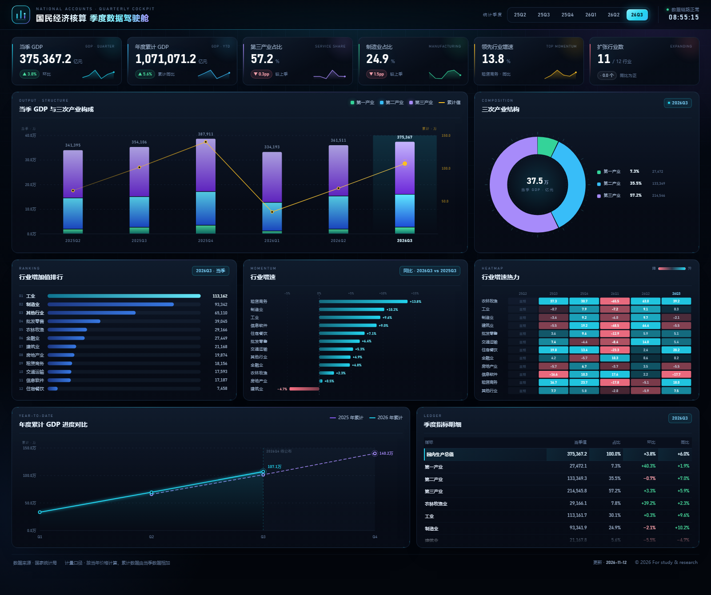

# 国民经济核算 · 季度数据驾驶舱

> 基于国家统计局季度数据（2025Q2 – 2026Q3）的静态可视化驾驶舱  
> 纯 HTML / CSS / JavaScript 实现，无第三方依赖，断网可用

## 目录

- [预览](#预览)
- [功能](#功能)
- [使用](#使用)
- [数据说明](#数据说明)
- [目录结构](#目录结构)
- [更新数据](#更新数据)
- [技术实现](#技术实现)

---

### 预览

点击进入驾驶舱：[index.html](./index.html)  
在线访问：https://olexiawu.github.io/Big-Data-Analysis-and-Data-Visualization-Experiment/national-accounts-dashboard/



### 功能

- 6 项关键指标：当季 GDP、年度累计 GDP、第三产业占比、制造业占比、领先行业增速、扩张行业数，均带迷你趋势线
- 7 个可视化模块：堆叠柱 + 双轴折线、环形结构图、行业排行榜、发散增速条形、行业 × 季度热力图、年度累计进度对比、季度指标明细表
- 季度联动：点击顶部季度按钮（或按 `←` / `→`），全部模块同步刷新；缺少上年同季数据时自动回退为环比口径，并在标签中注明对比基期
- 交互细节：悬浮提示、数字滚动、入场动效；支持 `prefers-reduced-motion`
- 响应式布局：宽屏 12 栏、平板 6 栏、手机单列，图表按容器尺寸实时重绘
- 深色科技主题：玻璃拟态面板、网格光晕背景、青色 / 紫色数据色板

### 使用

1. 直接双击 `index.html` 用浏览器打开
2. 或启动本地静态服务器（推荐）

```bash
cd national-accounts-dashboard
python -m http.server 8000
# 浏览器访问 http://localhost:8000
```

操作说明：

| 操作 | 效果 |
| --- | --- |
| 点击顶部 `25Q2 … 26Q3` | 切换统计季度，全部模块联动 |
| 悬停图表元素 | 显示数值、占比、环比 / 同比等明细 |
| 键盘 `←` / `→` | 上一季 / 下一季 |
| 地址追加 `#static` | 关闭全部动效，便于截图与打印 |

### 数据说明

- 数据来源：国家统计局 · 国民经济核算 · 季度数据
- 覆盖区间：2025 年第 2 季度 – 2026 年第 3 季度，共 6 个季度
- 指标数量：16 项（GDP、三次产业、12 个行业门类）的当季值与累计值
- 计量口径：按当年价格计算，累计数据由当季数据相加
- 派生指标：同比 = 本期 / 上年同季 − 1；环比 = 本期 / 上季 − 1；占比 = 增加值 / 当季 GDP
- 行业分类：采用《国民经济行业分类（GB/T 4754—2017）》，三次产业依据 2018 年修订的《三次产业划分规定》

口径提示：12 个行业增加值之和与 GDP 当季值一致（脚本已校验）；由于部分活动（如开采、修理等专业及辅助性活动）在产业与行业间归属不同，`农林牧渔业`、`工业` 会略高于对应的 `第一产业`、`第二产业`，属正常统计口径差异，图中均按原始表数值呈现。

### 目录结构

```text
national-accounts-dashboard/
├── index.html                  # 页面骨架（唯一入口）
├── assets/
│   ├── css/
│   │   └── style.css           # 设计令牌、布局、组件、响应式
│   └── js/
│       ├── data.js             # 由脚本生成的前端数据（勿手改）
│       ├── charts.js           # 手写 SVG 图表引擎（6 种图表 + 迷你折线）
│       └── app.js              # 指标派生、KPI、季度切换、明细表、重绘调度
├── data/
│   ├── raw/
│   │   └── quarterly_raw.csv   # 国家统计局原始导出（宽表）
│   ├── gdp_quarterly.csv       # 整洁长表（Excel 友好，UTF-8 BOM）
│   └── gdp_quarterly.json      # 结构化数据，便于二次开发
├── tools/
│   └── prepare_data.py         # 原始数据 → 数据文件 的转换脚本
├── docs/
│   └── preview.png             # 预览图
└── README.md
```

### 更新数据

1. 用国家统计局导出的最新季度数据覆盖 `data/raw/quarterly_raw.csv`（保持原表格式：表头 + 指标行）
2. 重新生成数据文件

```bash
python tools/prepare_data.py
```

脚本会校验「三次产业当季值之和 = GDP 当季值」，不一致时直接报错退出；季度表头自动解析（如 `2026年第三季度` → `2026Q3`），列顺序自动校正为时间正序。

### 技术实现

- 无构建、无依赖：原生 JavaScript（ES2015+）+ 现代 CSS，`file://` 直接打开亦可运行
- 图表引擎：`charts.js` 以字符串模板生成 SVG，自实现刻度、堆叠坐标、圆弧分段、发散轴与热力色阶
- 自适应：`ResizeObserver` 监听容器尺寸，变化超过 2px 才重绘
- 主题系统：颜色、字号、圆角收敛为 `:root` 设计令牌
- 可访问性：语义化标签、`aria-pressed` 状态、键盘切换、`prefers-reduced-motion` 降级

---

数据版权归国家统计局所有，本项目仅用于数据分析与可视化的学习研究。
